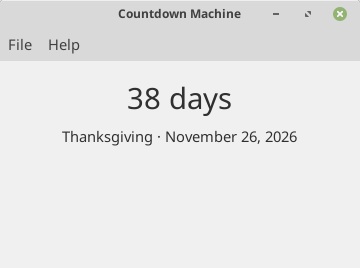

# Countdown Machine

A small GTK app for Linux Mint that shows how many days are left until a given date.



## Setting a date

Open **File -> Preferences**, give the event a name, and pick a date.

## Install

Download the latest `.deb` from the [Releases](../../releases) page, then double-click it, or run:

```
sudo apt install ./countdown-machine_1.0.1.deb
```

Countdown Machine will appear in the menu under Accessories.

To uninstall:

```
sudo apt remove countdown-machine
```

## Development

Run from the project folder without installing:

```
./dev-run.sh
```

This compiles the GSettings schema locally and launches the app against it.

The interface is in `usr/share/countdown-machine/countdown-machine.ui` and can be edited in Glade.

## Building the package

```
./build-deb.sh
```

The package is written to `build/`.

## Releasing a new version

Update the version number in:

- `packaging/control`
- `build-deb.sh`
- `VERSION` in `usr/lib/countdown-machine/countdown-machine.py`

Then build, commit, tag, and attach the `.deb` to a GitHub release.

## License

GPL-3.0. See `LICENSE`.